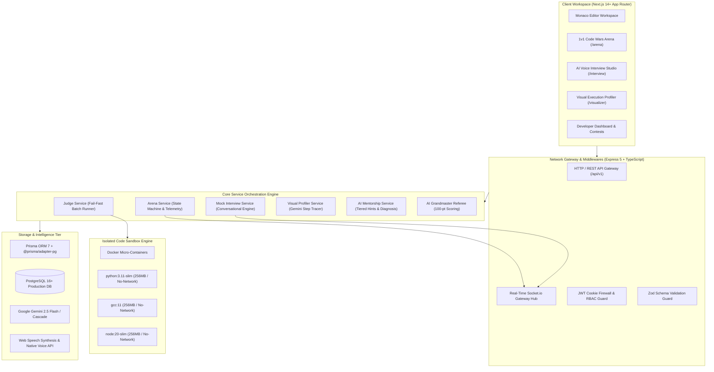
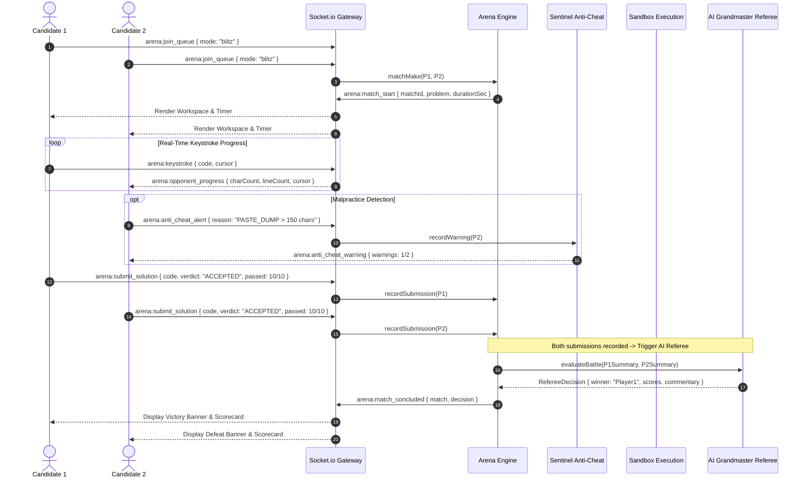
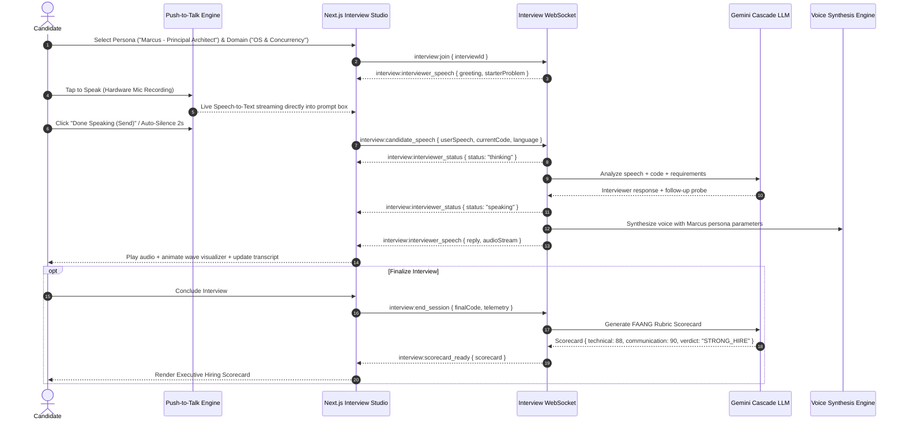
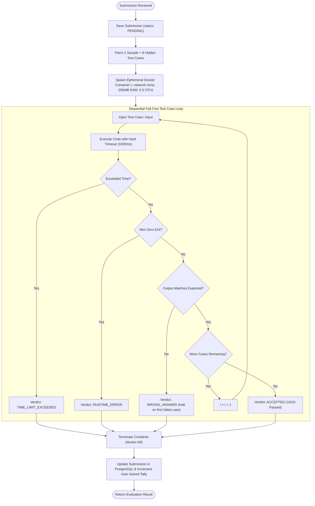

# 🏛️ System Architecture Specification — SynapseJudge

This document provides the definitive architectural blueprint of the software design patterns, architectural layers, data flows, security infrastructure, and real-time event loops governing the **SynapseJudge** online judge and engineering preparation platform.

---

## 1. High-Level Architectural Topology

SynapseJudge is engineered using a decoupled, **N-Tier Layered Architecture** with reactive micro-engines for real-time WebSocket communication, Docker micro-container sandboxing, and multimodal generative AI orchestration.

---

## 2. Real-Time 1v1 Arena WebSocket Pipeline

The **1v1 Code Wars Arena** operates over high-frequency bidirectional WebSockets managing matchmaking, live keystroke progress broadcasting, Sentinel anti-cheat malpractice detection, and post-match AI Grandmaster Referee evaluation.

---

## 3. Conversational AI Mock Interviewer Architecture

The **AI Mock Interviewer** allows candidates to simulate technical interviews using **Push-to-Talk speech**, real-time audio visualizers, and four calibrated voice personas across Computer Science domains.

---

## 4. Visual Algorithm Execution Profiler Pipeline

The **Visual Algorithm Execution Profiler** evaluates arbitrary student code dynamically and synthesizes a step-by-step memory frame timeline.

```mermaid
flowchart LR
    subgraph InputStage ["Input Parameters"]
        Code["Source Code (Python/JS)"]
        InputData["Test Input (e.g. nums=[2,7,11,15], target=9)"]
        Context["Problem Title / Presets"]
    end

    subgraph ProfilerEngine ["Visual Profiler Service"]
        PromptGen["Dynamic Line Tracer Prompt Generator"]
        CascadeAI["Gemini Cascade Inference"]
        Normalizer["Memory Frame Normalizer & Sanitizer"]
        Fallback["Deterministic Algorithmic Fallback Tracer"]
    end

    subgraph OutputFrames ["Structured JSON Execution Frames"]
        Steps["steps: Array<VisualStep>"]
        Arrays["arrays & pointers (low, mid, high)"]
        LinkedLists["linkedLists & node pointers (prev, curr, nxt)"]
        Stacks["stacks (PUSH_STACK, POP_STACK)"]
        Queues["queues (ENQUEUE, DEQUEUE)"]
        Trees["trees (TREE_TRAVERSE)"]
        Matrices["matrices (MATRIX_UPDATE)"]
    end

    subgraph CanvasRenderer ["Frontend Canvas & SVG Renderer"]
        Scrubber["Scrubber / Timeline Stepper"]
        MonacoSync["Active Line Monaco Highlight"]
        Animation["Animated Arrow Transitions"]
    end

    InputStage --> ProfilerEngine
    PromptGen --> CascadeAI
    CascadeAI --> Normalizer
    CascadeAI -.->|On Quota / Network Error| Fallback
    Normalizer --> OutputFrames
    Fallback --> OutputFrames
    OutputFrames --> CanvasRenderer
```

---

## 5. Docker Sandbox Execution & Fail-Fast Grading Loop

Untrusted candidate code is evaluated inside ephemeral Linux containers with strict kernel-level resource caps.

---

## 6. Security Infrastructure & Guardrails

| Layer | Threat Vector | Mitigation Strategy |
| :--- | :--- | :--- |
| **Authentication** | Credential stuffing & XSS | HttpOnly, SameSite=Lax, Secure cookies; Bcrypt password hashing (12 rounds). |
| **Code Execution** | Remote Code Execution (RCE), Fork bombs | Isolated Docker micro-containers, `--network none`, 256MB RAM limit, read-only root filesystems where applicable. |
| **Multiplayer Arena** | Clipboard paste malpractice, tab switching | Client-side Sentinel hooks detecting clipboard dumps (>150 characters) and window blur events with recorded infractions. |
| **Data Masking** | Malicious ID enumeration | Dual-ID architecture: `public_id` (random UUIDv4) for client APIs; internal `BIGINT` for performant database joins. |
| **API Abuse** | Redundant LLM calls & double-billing | Caching verified AI hints and diagnoses in database tables (`ai_feedback`). |