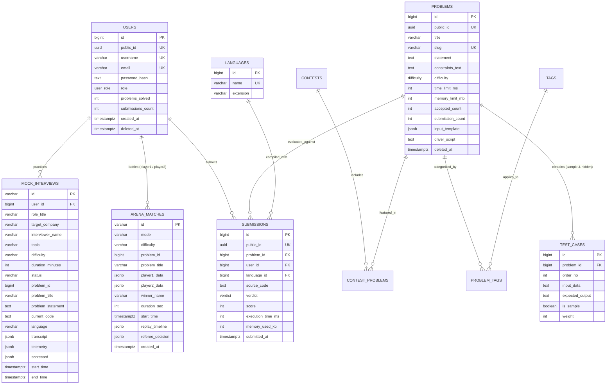

# 💾 Database Design & Relational Storage Specification — SynapseJudge

This document provides the definitive relational data model, indexing topology, entity relationships, and table schemas implemented in **PostgreSQL 16+** using **Prisma ORM 7+** and `@prisma/adapter-pg`.

---

## 1. Entity-Relationship (ER) Diagram



---

## 2. Advanced Relational Optimization Strategies

### A. Dual-ID Isolation Pattern
- **Internal Numerical Sequence (`id: BIGINT`):** Managed automatically as 64-bit sequence integers. All foreign keys, primary keys, and table joins operate on internal integers to minimize B-Tree index footprint and optimize CPU cache line alignment.
- **External Public Hash (`public_id: UUIDv4`):** Dispatched to client web applications and REST endpoints. Masks transaction counts and prevents sequential database enumeration attacks.

### B. High-Concurrency Partial Indexes
Production soft deletes use a nullable `deleted_at` timestamp. Conditional partial unique indexes allow instant recycling of handles, emails, and slugs:
```sql
CREATE UNIQUE INDEX idx_users_email_active ON users(email) WHERE deleted_at IS NULL;
CREATE UNIQUE INDEX idx_users_username_active ON users(username) WHERE deleted_at IS NULL;
CREATE UNIQUE INDEX idx_problems_slug_active ON problems(slug) WHERE deleted_at IS NULL;
```

### C. Composite Performance Index Arrays
High-throughput query channels use composite indexes to prevent table scans under heavy concurrent submissions:
- `test_cases(problem_id, order_no)`: Guarantees sequential reads during Docker sandbox execution.
- `submissions(user_id, problem_id)`: Accelerates personal dashboard performance calculations.
- `mock_interviews(user_id, created_at)`: Instant retrieval of interview history.

---

## 3. Enumerated Type (ENUM) Catalog

### `USER_ROLE`
- `USER`: Standard coder account privileges.
- `ADMIN`: Complete problem CRUD, batch test case creation, and AI generator tools.
- `MODERATOR`: Community editorial and problem moderation access.

### `DIFFICULTY`
- `EASY`: Fundamental algorithmic patterns (Two Pointers, Binary Search, Basic Arrays).
- `MEDIUM`: Dynamic programming, Trees, Graphs, Monotonic Stacks, Sliding Window.
- `HARD`: Advanced graph algorithms, Complex Concurrency, Segment Trees.

### `VERDICT`
- `PENDING`: Awaiting worker container assignment.
- `ACCEPTED`: Code produced exact expected outputs on all 10 sample + hidden cases within runtime constraints.
- `WRONG_ANSWER`: Output token mismatch against test case ground truth.
- `TIME_LIMIT_EXCEEDED`: Process exceeded configured CPU time limit.
- `MEMORY_LIMIT_EXCEEDED`: Container exceeded 256MB RAM limit.
- `RUNTIME_ERROR`: Unhandled exception, null pointer, or non-zero exit code.
- `SYSTEM_ERROR`: Internal infrastructure or filesystem timeout.

---

## 4. Comprehensive Schema Definitions

### 1. `users` Table
| Column Name | Type | Key | Nullable | Description |
|---|---|---|---|---|
| `id` | `BIGSERIAL` | Primary Key | No | Internal optimized integer ID. |
| `public_id` | `UUID` | Unique | No | Random UUIDv4 exposed to clients. |
| `username` | `VARCHAR(30)` | Unique | No | Alphanumeric handle. |
| `email` | `VARCHAR(255)` | Unique | No | Account email address. |
| `password_hash` | `TEXT` | — | No | Salted Bcrypt hash (12 rounds). |
| `role` | `USER_ROLE` | — | No | Account clearance (`USER`, `ADMIN`). |
| `problems_solved` | `INTEGER` | — | No | Running tally of unique accepted challenges. |
| `submissions_count`| `INTEGER` | — | No | Running tally of total attempts. |
| `created_at` | `TIMESTAMPTZ` | — | No | Registration timestamp. |
| `deleted_at` | `TIMESTAMPTZ` | — | Yes | Soft-delete marker. |

### 2. `problems` Table
| Column Name | Type | Key | Nullable | Description |
|---|---|---|---|---|
| `id` | `BIGSERIAL` | Primary Key | No | Internal numerical ID. |
| `public_id` | `UUID` | Unique | No | Random UUIDv4 for API routes. |
| `title` | `VARCHAR(255)` | — | No | Problem banner title. |
| `slug` | `VARCHAR(255)` | Unique | No | Clean URL slug (e.g. `two-sum`). |
| `statement` | `TEXT` | — | No | Problem description supporting Markdown & LaTeX. |
| `constraints_text` | `TEXT` | — | No | Input bounds and memory limits. |
| `difficulty` | `DIFFICULTY` | — | No | Challenge classification. |
| `time_limit_ms` | `INTEGER` | — | No | Allowed CPU execution time (default: 1000ms). |
| `memory_limit_mb` | `INTEGER` | — | No | Hard memory ceiling (default: 256MB). |
| `input_template` | `JSONB` | — | Yes | Starter function boilerplate per language. |
| `driver_script` | `TEXT` | — | Yes | Harness script for runner execution. |

### 3. `test_cases` Table
| Column Name | Type | Key | Nullable | Description |
|---|---|---|---|---|
| `id` | `BIGSERIAL` | Primary Key | No | Internal test case row ID. |
| `problem_id` | `BIGINT` | Foreign Key | No | References `problems(id)`. |
| `order_no` | `INTEGER` | — | No | Execution sequence index. |
| `input_data` | `TEXT` | — | No | Input data fed to `stdin`. |
| `expected_output`| `TEXT` | — | No | Expected output compared with `stdout`. |
| `is_sample` | `BOOLEAN` | — | No | If `true`, visible in UI. If `false`, hidden from candidates. |
| `weight` | `INTEGER` | — | No | Score weighting points. |

### 4. `arena_matches` Table (`ArenaMatchRecord`)
Persists completed 1v1 PvP matches, real-time keystroke timelines, and AI Grandmaster Referee decisions.
| Column Name | Type | Key | Nullable | Description |
|---|---|---|---|---|
| `id` | `VARCHAR(64)` | Primary Key | No | Match session key (e.g. `match_1793013811098_zmplc`). |
| `mode` | `VARCHAR(32)` | — | No | `classic` or `blitz`. |
| `difficulty` | `VARCHAR(32)` | — | No | `EASY`, `MEDIUM`, or `HARD`. |
| `problem_id` | `BIGINT` | — | No | Problem identifier. |
| `problem_title` | `VARCHAR(255)`| — | No | Title of the contested challenge. |
| `player1_data` | `JSONB` | — | No | Player 1 username, code, cases passed, warnings. |
| `player2_data` | `JSONB` | — | No | Player 2 username, code, cases passed, warnings. |
| `winner_name` | `VARCHAR(64)` | — | No | Declared winner or `Draw (Tie Game)`. |
| `duration_sec` | `INTEGER` | — | No | Battle time allocation. |
| `replay_timeline`| `JSONB` | — | No | Millisecond-stamped event array for Replay Theater. |
| `referee_decision`| `JSONB` | — | No | 100-pt rubric breakdown (correctness, efficiency, cleanliness, conduct). |
| `created_at` | `TIMESTAMPTZ` | — | No | Creation timestamp. |

### 5. `mock_interviews` Table (`MockInterview`)
Persists candidate technical interview simulations, push-to-talk transcripts, and FAANG scorecards.
| Column Name | Type | Key | Nullable | Description |
|---|---|---|---|---|
| `id` | `VARCHAR(64)` | Primary Key | No | Interview UUID string. |
| `user_id` | `BIGINT` | Foreign Key | No | References `users(id)`. |
| `role_title` | `VARCHAR(255)`| — | No | e.g. `Staff Systems Engineer (L6)`. |
| `target_company`| `VARCHAR(255)`| — | No | e.g. `Google`, `Palantir`, `Meta`. |
| `interviewer_name`| `VARCHAR(64)`| — | No | `Alex`, `Marcus`, `Sarah`, or `Elena`. |
| `topic` | `VARCHAR(128)`| — | No | `OS`, `CN`, `DBMS`, `SQL`, `OOP`, `Algorithms`. |
| `difficulty` | `VARCHAR(32)` | — | No | `EASY`, `MEDIUM`, `HARD`. |
| `status` | `VARCHAR(32)` | — | No | `IN_PROGRESS` or `COMPLETED`. |
| `transcript` | `JSONB` | — | No | Spoken turns array with candidate & interviewer dialogue. |
| `telemetry` | `JSONB` | — | No | Keystroke speed, pauses, and hint usage metrics. |
| `scorecard` | `JSONB` | — | Yes | Comprehensive hiring evaluation & score breakdown. |